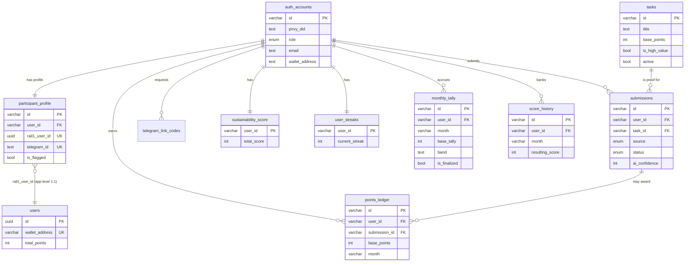

# BigWater Rail2 Backend Documentation — Database

This document has two parts, mirroring the rail1 database document's structure. Part I
is the database reference: technology, tables, relationships, and the schema diagram.
Part II describes how each subsystem works, its flow, and the database state changes
it drives. Section 0 covers rail2's relationship to rail1 up front, since almost every
table and flow in this document touches it.

Endpoints are named only to situate each flow; the full request/response shapes are the
subject of the separate API document.

## 0. Scope: no membership, no contracts, in rail2

Unlike rail1, **rail2 has no payment system and no on-chain component.** There is no
Stripe integration, no NFT contracts, no wallet-signed redemption flow, and no product
calendar. Rail2's entire job is: let a logged-in rail1 member submit photo proof of
real-world "sustainability" tasks, have a human (assisted by two AI checks) approve or
reject each one, and accumulate a **second, additive score** — visible on a combined
leaderboard alongside rail1's own `total_points`. If a membership or contracts
document is ever needed for rail2, there is nothing to write yet; this is a deliberate,
current gap, not an oversight.

## Part I: Database reference

### Technology

- **Engine:** PostgreSQL — the **same physical database** rail1 uses. Rail2 does not
  provision its own database instance; it is handed the same `DATABASE_URL`.
- **Access layer:** Drizzle ORM (`drizzle-orm/postgres-js`), via the `postgres` driver.
- **Migrations:** `drizzle-kit`. Critically, `drizzle.config.ts`'s `schema` field points
  only at `src/db/schema/rail2.ts` — rail1's `users` table (vendored into this repo as
  `src/db/schema/rail1.ts`, headed "owned by rail1") is **excluded from rail2's
  migrations**. Rail2 can query and join against it, but `drizzle-kit generate` /
  `migrate` never touches it, and never will unless that config changes.
- **Primary keys:** rail2's own tables use a custom **lowercase alphanumeric nanoid**
  (`customAlphabet("abcdefghijklmnopqrstuvwxyz0123456789")`, default length),
  generated **application-side** (`$defaultFn(nanoid)`), stored as `varchar`. This is a
  deliberate departure from rail1's server-side `gen_random_uuid()` UUIDs — the two ID
  formats are visually distinguishable, which matters when the same log line or admin
  screen shows both a rail2 `authUsers.id` and a rail1 `users.id` side by side.
  Exceptions: `sustainabilityScore` and `userStreaks` are keyed directly by `userId`
  (no separate surrogate key, since each is a strict 1:1 with a user), and
  `telegramLinkCodes` is keyed by the link `code` itself.
- **Timestamps:** all `timestamptz` (UTC, timezone-aware), `createdAt`/`updatedAt`
  defaulted via `defaultNow()`. Unlike rail1, `updatedAt` is **not** auto-refreshed by a
  database trigger on every update — call sites that mutate a row are individually
  responsible for setting `updatedAt: new Date()`, and not every one does (see the
  callouts under each table below).
- **Enums:** native Postgres enums for `user_role`, `submission_status`,
  `submission_source`.
- **JSON:** none in rail2's schema (no JSONB columns).
- **Money:** none — rail2 has no currency; everything is unitless integer "points."

### Tables

#### `auth_accounts` (Drizzle export: `authUsers`)

The root account for every rail2 user — members **and** admins share this one table,
distinguished by `role`.

| Column                     | Type             | Notes                                                                                                                                                                                                                   |
| -------------------------- | ---------------- | ----------------------------------------------------------------------------------------------------------------------------------------------------------------------------------------------------------------------- |
| `id`                       | varchar PK       | nanoid                                                                                                                                                                                                                  |
| `privy_did`                | text, unique     | The Privy DID once claimed. For an admin created via the invite flow before their first login, this column temporarily holds the raw email/wallet-address string used as the invite identifier — see the admin document |
| `role`                     | enum `user_role` | `user` \| `admin` \| `superadmin`, default `user`                                                                                                                                                                       |
| `status`                   | text             | `active` by default; `inactive` marks a revoked admin (see the admin document)                                                                                                                                          |
| `email`                    | text, unique     | Nullable                                                                                                                                                                                                                |
| `username`                 | text, unique     | Nullable — set for password-login admins                                                                                                                                                                                |
| `password_hash`            | text             | Nullable — a row without one cannot log in via password                                                                                                                                                                 |
| `wallet_address`           | text, unique     | Nullable — an EVM address, populated for Privy-linked admins; **not** the same column as a regular member's wallet, which lives on rail1's `users` table instead                                                        |
| `created_at`, `updated_at` | timestamptz      |                                                                                                                                                                                                                         |

A row exists here for **every** rail2 user, member or admin. A plain member's row is
created lazily on first login (see section 1).

#### `participant_profile` (Drizzle export: `participantProfile`)

The rail2-specific profile for a regular member. Exists in a strict 1:1 with
`auth_accounts`, and (unusually) in a strict 1:1 with a rail1 `users` row too.

| Column                     | Type                                                     | Notes                                                                                                                                                                                                                                                                                                                |
| -------------------------- | -------------------------------------------------------- | -------------------------------------------------------------------------------------------------------------------------------------------------------------------------------------------------------------------------------------------------------------------------------------------------------------------- |
| `id`                       | varchar PK                                               | nanoid                                                                                                                                                                                                                                                                                                               |
| `user_id`                  | varchar, unique, FK → `auth_accounts.id`, cascade delete |                                                                                                                                                                                                                                                                                                                      |
| `rail1_user_id`            | uuid, **unique, not null**                               | FK-shaped but not a real Postgres foreign key (rail1's table isn't in this schema's migration graph) → rail1 `users.id`. Unique in both directions: one rail2 profile per rail1 member, and vice versa                                                                                                               |
| `username`                 | text                                                     | Nullable; the _Telegram_ display name, set when a Telegram account is linked (not the login username)                                                                                                                                                                                                                |
| `telegram_id`              | text, unique                                             | Nullable                                                                                                                                                                                                                                                                                                             |
| `is_member`                | boolean                                                  | Default `false`. **Not currently set to `true` anywhere in the codebase** — every write path that touches this column writes other fields, never this one, so it stays at its default for every profile created so far. Treat it as reserved/aspirational rather than load-bearing until something starts setting it |
| `is_flagged`               | boolean                                                  | Default `false`; blocks new submissions when `true`                                                                                                                                                                                                                                                                  |
| `status`                   | text                                                     | Default `active`; not currently read anywhere outside display                                                                                                                                                                                                                                                        |
| `created_at`, `updated_at` | timestamptz                                              |                                                                                                                                                                                                                                                                                                                      |

#### `tasks`

The catalog of sustainability actions a member can submit proof for.

| Column                             | Type        | Notes                                                                                                                 |
| ---------------------------------- | ----------- | --------------------------------------------------------------------------------------------------------------------- |
| `id`                               | varchar PK  | nanoid                                                                                                                |
| `title`, `description`, `category` | text        | `description` nullable                                                                                                |
| `base_points`                      | int         | Default 0 — points awarded on approval                                                                                |
| `is_high_value`                    | boolean     | Default `false` — gates the separate daily high-value cap                                                             |
| `active`                           | boolean     | Default `true` — the on/off switch; inactive tasks disappear from both the web catalog and the Telegram `/tasks` list |
| `created_at`, `updated_at`         | timestamptz |                                                                                                                       |

There is no "delete blocked once completed" guard here the way rail1's quest catalog
has one — rail2 has no admin delete-task endpoint at all yet (only create, update,
activate, deactivate).

#### `submissions`

One row per proof photo submitted, whether from the web app or the Telegram bot.

| Column                     | Type                                                  | Notes                                                                                                            |
| -------------------------- | ----------------------------------------------------- | ---------------------------------------------------------------------------------------------------------------- |
| `id`                       | varchar PK                                            | nanoid                                                                                                           |
| `user_id`                  | varchar, FK → `auth_accounts.id`, cascade delete      |                                                                                                                  |
| `task_id`                  | varchar, FK → `tasks.id`, **and** marked `.notNull()` | See the callout below                                                                                            |
| `source`                   | enum `submission_source`                              | `web` \| `telegram`                                                                                              |
| `status`                   | enum `submission_status`                              | `pending` \| `under_review` \| `approved` \| `rejected`, default `pending`                                       |
| `image_url`                | text                                                  | Nullable in the type, but every write path sets it — the public/CDN URL of the uploaded proof photo              |
| `ai_confidence`            | int                                                   | Nullable — the combined 0–100 AI score, set once the evaluation worker (or an external caller) reports a verdict |
| `ai_verdict`               | text                                                  | Nullable — the one-sentence rationale shown to the reviewing admin                                               |
| `created_at`, `updated_at` | timestamptz                                           |                                                                                                                  |

**Worth knowing:** `task_id`'s foreign key is declared with `onDelete: "set null"`,
but the column itself is declared `.notNull()` in the same statement. Those two
constraints contradict each other — if a referenced task were ever deleted, Postgres
would try to null out a `NOT NULL` column and the delete would fail with a constraint
violation rather than silently orphaning the submission. In practice this is
unreachable today (there's no "delete task" endpoint), but it's a latent trap if one is
added later without revisiting this column.

There's also a vestigial `/// will be removed` admin endpoint
(`getCustomSubmissions`) that queries for submissions with a **null** `task_id` —
which, per the constraint above, should never exist. Read it as dead code from an
earlier schema shape rather than a feature to build against.

#### `submission_limits`

A **singleton** configuration row (the app always does `findFirst()`, never filters by
ID) governing daily submission behavior for every member.

| Column                     | Type        | Notes                                                                                                                                                                                                                                                                                                                                                                                                                                                                                                          |
| -------------------------- | ----------- | -------------------------------------------------------------------------------------------------------------------------------------------------------------------------------------------------------------------------------------------------------------------------------------------------------------------------------------------------------------------------------------------------------------------------------------------------------------------------------------------------------------- |
| `id`                       | varchar PK  | nanoid                                                                                                                                                                                                                                                                                                                                                                                                                                                                                                         |
| `cooldown_hours`           | int         | Default `6` — **misleadingly named: treated as raw milliseconds everywhere it's read**, not hours. The seed script inserts `21600000` (which is 6 hours in ms) into this column, and `enforceSubmissionLimits`/`getSubmissionLimitStatus` both add it to a timestamp with no unit conversion. Anyone hand-editing this value from the admin UI without knowing this will set the cooldown to whatever number of _milliseconds_ they type — e.g. entering `6` (intending 6 hours) sets a 6-millisecond cooldown |
| `max_submissions_per_day`  | int         | Default `4`                                                                                                                                                                                                                                                                                                                                                                                                                                                                                                    |
| `max_high_value_per_day`   | int         | Default `1`                                                                                                                                                                                                                                                                                                                                                                                                                                                                                                    |
| `monthly_tally_cap`        | int         | Default `1000` — declared and admin-editable, but **not enforced anywhere** in the current tally/banking code (no query clamps `baseTally` against it)                                                                                                                                                                                                                                                                                                                                                         |
| `streak_enabled`           | boolean     | Default `true` — declared and admin-editable, but **not read anywhere**; streak tracking runs unconditionally regardless of this flag's value                                                                                                                                                                                                                                                                                                                                                                  |
| `created_at`, `updated_at` | timestamptz |                                                                                                                                                                                                                                                                                                                                                                                                                                                                                                                |

#### `points_ledger` (Drizzle export: `pointsLedger`)

Append-only audit trail of every point award — the source of truth a `monthlyTally`
row is supposed to be the running sum of.

| Column          | Type                                                   | Notes                                                                                                   |
| --------------- | ------------------------------------------------------ | ------------------------------------------------------------------------------------------------------- |
| `id`            | varchar PK                                             | nanoid                                                                                                  |
| `user_id`       | varchar, FK → `auth_accounts.id`, cascade delete       |                                                                                                         |
| `submission_id` | varchar, FK → `submissions.id`, **set null** on delete | Null for a manual admin adjustment (see the admin document)                                             |
| `base_points`   | int                                                    | The raw points awarded, before any band multiplier or streak bonus                                      |
| `month`         | varchar                                                | The tally-period key this award belongs to (see "Tally periods" below)                                  |
| `created_at`    | timestamptz                                            | Indexed (`points_ledger_created_at_idx`) — the admin overview's weekly/30-day breakdowns filter on this |

#### `sustainability_score` (Drizzle export: `sustainabilityScore`)

The member's **banked, permanent** rail2 score — the number that, once earned, "never
drops" (a promise made explicitly in the Telegram bot's copy).

| Column        | Type                                                | Notes                                                                                                                                                                 |
| ------------- | --------------------------------------------------- | --------------------------------------------------------------------------------------------------------------------------------------------------------------------- |
| `user_id`     | varchar PK, FK → `auth_accounts.id`, cascade delete | No separate surrogate key                                                                                                                                             |
| `total_score` | int                                                 | Default 0                                                                                                                                                             |
| `head_start`  | int                                                 | Default 0 — declared, but **never written to** anywhere in the current codebase; every read of it therefore returns 0. Reserved for a future "starting bonus" feature |
| `updated_at`  | timestamptz                                         |                                                                                                                                                                       |

A row here is created lazily, at month-end banking (see Part II), not at signup — a
brand-new member has no row at all until their first month closes with earned points.

#### `monthly_tally` (Drizzle export: `monthlyTally`)

The **in-progress** tally for one member for one tally period — this is what actually
accumulates points from approved submissions during the month; it gets "banked" into
`sustainability_score` once the period closes.

| Column                     | Type                                             | Notes                                                                                                                                                                                                                                                                                                                                       |
| -------------------------- | ------------------------------------------------ | ------------------------------------------------------------------------------------------------------------------------------------------------------------------------------------------------------------------------------------------------------------------------------------------------------------------------------------------- |
| `id`                       | varchar PK                                       | nanoid                                                                                                                                                                                                                                                                                                                                      |
| `user_id`                  | varchar, FK → `auth_accounts.id`, cascade delete |                                                                                                                                                                                                                                                                                                                                             |
| `month`                    | varchar                                          | The tally-period key                                                                                                                                                                                                                                                                                                                        |
| `base_tally`               | int                                              | Default 0 — running sum of points earned this period, before the band multiplier                                                                                                                                                                                                                                                            |
| `band`                     | text                                             | Default `"seedling"` — the band name this tally currently sits in (recomputed after every award)                                                                                                                                                                                                                                            |
| `multiplier`               | int                                              | Default 50 (meaning 0.5×; stored as an integer percentage — see "Bands" below)                                                                                                                                                                                                                                                              |
| `streak_bonus`             | int                                              | Default 0 — **declared, but never written to.** The streak bonus is actually looked up fresh (from `streak_bonuses`) at banking time and applied straight into the banked-amount calculation; it's never persisted onto this row first. Read this column with that in mind — it does not reflect the streak bonus that was actually applied |
| `banked_amount`            | int                                              | Default 0 — filled in once, at banking time, with the exact amount added to `sustainability_score.total_score`                                                                                                                                                                                                                              |
| `period_end`               | timestamptz                                      | When this period closes and becomes eligible for banking                                                                                                                                                                                                                                                                                    |
| `is_finalized`             | boolean                                          | Default `false`; flipped to `true` by the banking worker, which is also the concurrency guard against double-banking                                                                                                                                                                                                                        |
| `created_at`, `updated_at` | timestamptz                                      |                                                                                                                                                                                                                                                                                                                                             |

**Constraint:** `unique(user_id, month)` — this is what makes the
`insert(...).onConflictDoUpdate(...)` upsert pattern used throughout the economy
services safe under concurrent submissions.

#### `user_streaks` (Drizzle export: `userStreaks`)

One row per member, tracking consecutive days of _approved_ activity.

| Column               | Type                                                | Notes                                                                                  |
| -------------------- | --------------------------------------------------- | -------------------------------------------------------------------------------------- |
| `user_id`            | varchar PK, FK → `auth_accounts.id`, cascade delete |                                                                                        |
| `current_streak`     | int                                                 | Default 0                                                                              |
| `longest_streak`     | int                                                 | Default 0                                                                              |
| `last_activity_date` | timestamptz                                         | Nullable — the day (per the configured day-period) of the most recent counted approval |
| `updated_at`         | timestamptz                                         |                                                                                        |

#### `score_history` (Drizzle export: `scoreHistory`)

One immutable row per member per **banked** month — the audit record of exactly how a
banking event computed a member's new total.

| Column                                               | Type                                             | Notes                                                                                                        |
| ---------------------------------------------------- | ------------------------------------------------ | ------------------------------------------------------------------------------------------------------------ |
| `id`                                                 | varchar PK                                       | nanoid                                                                                                       |
| `user_id`                                            | varchar, FK → `auth_accounts.id`, cascade delete |                                                                                                              |
| `month`                                              | varchar                                          |                                                                                                              |
| `tally`                                              | int                                              | The period's `base_tally` at banking time                                                                    |
| `band`, `multiplier`                                 | text, int                                        | Snapshotted at banking time                                                                                  |
| `streak_bonus_percent`                               | int                                              | Default 0 — the streak bonus actually applied (unlike `monthly_tally.streak_bonus`, this one _is_ filled in) |
| `starting_score`, `banked_amount`, `resulting_score` | int                                              | Before/delta/after — `resulting_score = starting_score + banked_amount`                                      |
| `created_at`                                         | timestamptz                                      |                                                                                                              |

**Constraint:** `unique(user_id, month)` — a month can only be banked once per user,
which is also the natural place a future audit query would check for banking gaps.

#### `telegram_link_codes`

Short-lived one-time codes that connect a Telegram account to a web-authenticated
rail2 account.

| Column        | Type                                             | Notes                                                                                                                         |
| ------------- | ------------------------------------------------ | ----------------------------------------------------------------------------------------------------------------------------- |
| `code`        | text PK                                          | The code itself is the primary key (not a separate ID) — an 8-character code from a 32-character alphabet, generated app-side |
| `user_id`     | varchar, FK → `auth_accounts.id`, cascade delete |                                                                                                                               |
| `expires_at`  | timestamptz                                      | 10 minutes after generation                                                                                                   |
| `consumed_at` | timestamptz                                      | Nullable — set once redeemed; a code is single-use                                                                            |
| `created_at`  | timestamptz                                      |                                                                                                                               |

#### `streak_bonuses`

Admin-configurable lookup table: at how many consecutive days does a bonus percentage
kick in.

| Column          | Type            | Notes                                                                                                                     |
| --------------- | --------------- | ------------------------------------------------------------------------------------------------------------------------- |
| `id`            | varchar PK      | nanoid                                                                                                                    |
| `streak_days`   | int, **unique** | The threshold                                                                                                             |
| `bonus_percent` | int             | The bonus applied at banking time once `current_streak >= streak_days` (the **highest** threshold met wins — see Part II) |
| `created_at`    | timestamptz     |                                                                                                                           |

There is no seed data for this table and no admin CRUD endpoints for it in the routes
inspected — rows would need to be inserted directly today. An empty table simply means
every streak bonus resolves to 0%.

#### `bands`

Admin-configurable tiers that set the multiplier applied to a member's monthly tally.

| Column                     | Type        | Notes                                            |
| -------------------------- | ----------- | ------------------------------------------------ |
| `id`                       | varchar PK  | nanoid                                           |
| `name`                     | text        |                                                  |
| `min_points`, `max_points` | int         | Inclusive range this band covers                 |
| `multiplier`               | int         | Stored as an integer **percentage** (100 = 1.0×) |
| `order`                    | int         | Display/lookup order                             |
| `created_at`               | timestamptz |                                                  |

Seeded on first boot with five bands (Seedling 0–399 @ 0.5×, Growing 400–599 @ 1.0×,
Thriving 600–799 @ 1.5×, Flourishing 800–949 @ 2.0×, Regenerative 950–1000 @ 3.0×) —
see `seedBands()`. Band lookups are cached in-process for 60 seconds
(`getBands()` in `src/services/economy/bands.ts`), so an admin edit to a band's range
or multiplier can take up to a minute to take effect across the fleet.

### Rail1 tables referenced (not owned by rail2)

#### `users` (Drizzle export in this repo: `rail1Users`)

Vendored verbatim from rail1's schema so rail2 can type and join against it. See the
rail1 database document for the authoritative column list; the columns rail2 actually
reads/writes are:

- `id` (uuid) — joined via `participant_profile.rail1_user_id`
- `wallet_address` — surfaced on the profile, leaderboard, and admin participant list
  as "the" wallet address for a rail2 user
- `total_points` — **read** everywhere a combined score is shown (profile,
  leaderboard, admin overview), and **written** in exactly one place: crediting 50
  points on a member's first-ever Telegram link (see Part II, section 4)
- `created_at` — used only for the admin overview's "new members this week" stat

### Relationships

- `auth_accounts` 1:1 `participant_profile` (`participant_profile.user_id` unique FK,
  cascade delete) — modeled as a Drizzle relation (`src/db/schema/relations.ts`) so
  `db.query.authUsers.findFirst({ with: { participantProfile: true } })` works.
- `participant_profile.rail1_user_id` ↔ `users.id` — unique in both directions
  (application-enforced 1:1; not a real database FK across the schema boundary).
- `auth_accounts` 1:N `submissions`, `points_ledger`, `telegram_link_codes` — all
  cascade on user delete.
- `auth_accounts` 1:1 `sustainability_score`, `user_streaks` (both keyed directly by
  `user_id`, cascade delete).
- `auth_accounts` 1:N `monthly_tally`, `score_history` — each constrained to one row
  per `(user_id, month)`.
- `tasks` 1:N `submissions`.
- `submissions` 1:N `points_ledger` (nullable — an admin manual adjustment has no
  submission behind it).
- `bands`, `streak_bonuses`, `submission_limits` — standalone lookup/config tables,
  no inbound foreign keys.

### Schema diagram

`users` here is rail1's table, shown for the one relationship that crosses the
boundary; everything else about it belongs in rail1's own documentation.

## Part II: How the system works

### 1. Authentication and identity

**Purpose.** Establish who the caller is, lazily provisioning a rail2 account and (for
regular members) linking it to the caller's existing rail1 membership.

**Entry points.** Every route under `/api/*` (except `/api/admin/login`) runs behind
`privyAuth` then `requireAuth`; routes under `/api/admin/*` run behind
`adminSessionAuth` + `requireAdmin` instead (see the admin document); `/internal/*`
runs behind a static API-key check (`requireServiceAuth`).

**Flow (member login).**

1. The frontend authenticates with Privy and sends the resulting access token as
   `Authorization: Bearer <token>`.
2. The backend verifies it against Privy's JWKS (`privy.utils().auth().verifyAccessToken`),
   with one transparent retry after a 150ms delay if the failure looks transient
   (a JWKS/JWT-shaped error message) rather than a genuinely invalid token.
3. It looks up `auth_accounts` by `privy_did`.
   - **Existing account, `role !== "user"`** (i.e. an admin/superadmin hitting a plain
     member route): returned as-is — an admin is never forced through the rail1-link
     flow just because they have no rail1 account.
   - **Existing account, `role === "user"`, no `rail1_user_id` linked yet:** the
     request must carry an `X-Rail1-Token` header — a JWT issued by rail1. Rail2
     verifies it itself (`verifyRail1Token`, HS256, shared `RAIL1_JWT_SECRET`),
     checking that the token carries **no** `scope` claim (mirroring rail1's own rule
     that a full member identity token is unscoped) and that its `sub` claim is a
     well-formed UUID. On success, that UUID is written into
     `participant_profile.rail1_user_id`. Missing or invalid tokens fail the whole
     request with a `401 rail1_link_error` — see the API document.
   - **Existing account, already linked:** returned as-is.
   - **No account at all:** requires `X-Rail1-Token` (same verification as above), then
     inserts a new `auth_accounts` row and a new `participant_profile` row (with the
     resolved `rail1_user_id`) in one transaction.
4. The resolved account (with its `participantProfile` attached) is stashed on the
   Hono context as `user` for the rest of the request.

**Database state changes.** `auth_accounts` inserted on first-ever login for a Privy
DID. `participant_profile` inserted alongside it for a brand-new member, or updated
in place (just the `rail1_user_id` column) for an existing member linking rail1 for
the first time.

**Invariants.** `auth_accounts.privy_did` is unique.
`participant_profile.rail1_user_id` is unique — enforced by the database column
constraint, so two rail2 accounts can never end up pointing at the same rail1 member.

**Edge cases.** A rail1-link failure (missing/invalid token) is surfaced as a distinct
error (`Rail1LinkError`) so the API layer can return a clear `rail1_link_error` code
instead of a generic 500. A token-verification failure that looks transient (JWKS
fetch blip) gets one retry before being treated as a hard auth failure.

### 2. Tasks

**Purpose.** The catalog of sustainability actions members can submit proof for.

**Entry points.** `GET /api/tasks` (member-facing, active tasks only); the full
admin CRUD set — `GET /api/admin/tasks`, `POST /api/admin/tasks`, `PATCH
/api/admin/tasks/:id`, `PATCH /api/admin/tasks/:id/activate`, `PATCH
/api/admin/tasks/:id/deactivate`.

**Flow.** Creation and update are validated by Zod schemas (`createTaskSchema`,
`updateTaskSchema`); the member-facing list is simply `active = true`, newest first.
Creating a task also enqueues a `task-notification` BullMQ job, which broadcasts an
announcement to every member with a linked Telegram account (see section 8).

**Database state changes.** Straightforward `tasks` inserts/updates. There is no
delete endpoint — deactivating is the only way to retire a task, and (unlike rail1's
quest catalog) this isn't because of a completion-history guard; a delete endpoint
simply doesn't exist yet.

**Invariants.** None enforced beyond the column types — `basePoints` is validated
non-negative at the API boundary (Zod), not by a database constraint.

### 3. Submissions

**Purpose.** Let a member submit a photo as proof a task was completed, enforcing
daily/cooldown limits and running the AI checks before it reaches a human reviewer.

**Entry points.** `POST /api/submissions/send` (web, `multipart/form-data`: `taskId` +
`file`); the Telegram bot's `submitProof` conversation calls the same underlying
service with `source: "telegram"`. `GET /api/submissions/:id`, `GET
/api/participants/submissions`, `GET /api/submissions/limits` for reading back.

**Flow.**

1. The caller's `participant_profile` is loaded; a flagged (`is_flagged: true`) member
   is refused with a `403` before anything else runs.
2. `enforceSubmissionLimits` checks, in order: no existing (non-rejected) submission for
   this exact task **today**; the cooldown since the member's most recent submission of
   any kind has elapsed; the daily submission cap hasn't been hit; if the task is
   high-value, the separate daily high-value cap hasn't been hit either. Any failure
   raises `SubmissionRejectedError` with a `429` and a message describing which limit
   was hit.
3. **Authoritative image validation** (`detectAndValidateImage`) — checks the file's
   actual byte signature (via `file-type`, magic-number sniffing), never the
   client-supplied MIME type or filename. Only JPEG and PNG pass; max 1MB. This runs
   **before** any upload to storage, so a rejected file is never written anywhere.
4. The validated file is uploaded (S3 or local — see the infrastructure document), and
   a `submissions` row is inserted with `status: "pending"`.
5. A `submission-evaluation` BullMQ job is enqueued (jobId = the submission's own ID,
   so retries/duplicates are naturally deduplicated by BullMQ) — see section 5.

**Database state changes.** One `submissions` row per attempt (rejected-by-limits
attempts never reach the database at all — the limit check runs first).

**Invariants.** None at the database level beyond the FK/enum constraints — the
"one submission per task per day" and cooldown rules are enforced entirely in
application code, not by a unique index, so they are subject to the same kind of race
a concurrent double-click could in principle exploit (no transaction wraps the check +
insert together).

**Edge cases.** The `task_id`/`NOT NULL` contradiction noted in Part I; the vestigial
"custom submissions" (null-task) admin query, which should never match any real row
under the current schema.

### 4. Telegram linking

**Purpose.** Connect a member's Telegram account to their web-authenticated rail2
account, for bot-based task submission and notifications.

**Entry points.** `POST /api/telegram/link-code` (web, authenticated — generates a
code); the bot's `/start <code>` handler (redeems it).

**Flow.**

1. The web app calls `POST /api/telegram/link-code`; the backend generates an 8-character
   code (from a 32-character alphabet, avoiding visually ambiguous characters) with a
   10-minute expiry and stores it in `telegram_link_codes`, and returns it so the
   frontend can build a `t.me/<bot>?start=<code>` deep link.
2. The member opens that link in Telegram; `/start <code>` fires with the code as the
   deep-link payload.
3. The bot redeems it (`redeemTelegramLinkCode`, run inside one transaction): rejects
   an invalid/expired/already-consumed code, and rejects if this Telegram account is
   already linked to a **different** rail2 profile. Otherwise, it writes the Telegram
   ID and display name onto `participant_profile`, marks the code consumed, and — if
   this is the member's **first-ever** Telegram link (checked by reading the profile's
   `telegram_id` **before** the update, so switching to a different Telegram account
   later doesn't re-trigger this) — credits **50 points directly onto rail1's
   `users.total_points`**, in the same transaction.

**Database state changes.** `participant_profile.telegram_id`/`username` updated;
`telegram_link_codes.consumed_at` set; on first link only, `rail1Users.total_points`
incremented by 50 (a direct cross-schema write — see the callout in the
infrastructure document about why this is safe here: same Postgres instance, same
transaction).

**Invariants.** `participant_profile.telegram_id` is unique, so one Telegram account
can never be linked to two rail2 profiles.

**Edge cases.** If a member's rail1 link was never established (shouldn't happen given
the auth flow in section 1, but the code defends against it anyway), the 50-point
award is skipped and logged as a warning rather than thrown — Telegram linking itself
still succeeds.

### 5. AI-assisted evaluation

**Purpose.** Give a human reviewer a fast, defensible starting signal on every
submission before they approve or reject it.

**Entry points.** Not a public endpoint — triggered automatically by the
`submission-evaluation` BullMQ job enqueued in section 3. (A separate, key-authenticated
internal endpoint, `PATCH /internal/submissions/:id/review`, exists for an **external**
service to report a verdict the same way — see the API document's callout on this;
nothing in this repo currently calls it.)

**Flow.**

1. The worker fetches the submission's stored image and runs two checks
   **concurrently** (`Promise.allSettled`, each wrapped in its own up-to-3-attempt
   retry with linear backoff): Sightengine (AI-generation probability → an
   "authenticity" score) and an OpenRouter vision-model call (task-relevance score +
   one-sentence rationale).
2. If **either** check ultimately fails after retries, the whole evaluation throws —
   the submission is deliberately left at `pending` rather than scored from a partial
   result. (There is no separate retry/backoff on the BullMQ job level shown pushing
   this back to `pending → under_review` automatically; a stuck `pending` submission
   needs either a job retry to succeed or admin attention.)
3. On success, the two 0–100 scores are combined: the geometric mean, **capped** at
   1.25× the weaker of the two scores whenever that weaker score is below 40 — so one
   badly failing check can't be fully offset by the other one passing cleanly.
4. The submission is updated with `ai_confidence` (the combined score, 0–100),
   `ai_verdict` (a generated sentence — reusing the relevance model's own sentence when
   both scores look fine, or a synthesized red-flag sentence when one or both are
   weak), and `status: "under_review"`.

**Database state changes.** `submissions.ai_confidence`, `ai_verdict`, `status`
updated in place.

**Invariants.** A submission only reaches `under_review` through this path (or the
internal-endpoint path, unused today) — never directly from creation.

### 6. Admin review

**Purpose.** The human decision point: approve (award points) or reject a submission
that's reached `under_review`.

**Entry points.** `GET /api/admin/submissions/review` (the queue), `PATCH
/api/admin/submissions/:id/review` (the decision), `GET
/api/admin/submissions/approved-rejected` (history), `DELETE
/api/admin/submissions/:id`.

**Flow.** All inside one database transaction:

1. The submission must currently be `under_review` — anything else (including a
   double-submitted review) is refused with `409`.
2. **On approval:** `processApprovedSubmission` runs (points ledger insert + monthly
   tally upsert + band recompute — see section 7), and `updateUserStreak` runs (streak
   bump/reset based on the submission's _creation_ date, not the review date — see
   section 9).
3. The submission's `status` flips to `approved`/`rejected`.
4. Whether this member's very first submission ever, and whether their very first
   _approved_ submission ever, are both computed (by checking for any other row for
   this user) — these flags drive which notification copy the Telegram worker sends.
5. A `submission-notification` job is enqueued (only meaningful if the member has a
   linked Telegram account — the worker no-ops otherwise).

**Database state changes.** See sections 7 and 9 for the approval side-effects;
`submissions.status`/`updated_at` always updated.

**Invariants.** A submission can only be reviewed once from `under_review` — the
status check inside the transaction is the guard (not a database-level constraint, so
this relies on the transaction's isolation, not a unique index).

### 7. Points, tallies and bands

**Purpose.** Turn an approved submission's base points into a running monthly total,
banded by a multiplier that rewards higher monthly activity.

**Flow (`processApprovedSubmission`).**

1. Insert a `points_ledger` row for the raw award.
2. Upsert `monthly_tally` for `(userId, currentTallyPeriod)` — increment `base_tally`
   by the awarded points if a row already exists this period, else create one.
3. Recompute the tally's `band`/`multiplier` from the new `base_tally`, via
   `getBandForMonthlyTally` (first band whose `[minPoints, maxPoints]` range contains
   the value; falls back to the highest band if the tally exceeds every configured
   range).

**Tally periods.** `getTallyPeriod()` resolves the "month" key two different ways
depending on `TALLY_PERIOD_MS`:

- **Unset in production** (or explicitly `0`): a real calendar month, keyed
  `"yyyy-MM"`.
- **Unset outside production:** a 10-minute fixed period (for fast local testing of
  the month-end banking flow) — key format `"p<index>"`.
- **Explicitly set to any positive number:** a fixed period of that length, in either
  environment — same `"p<index>"` key format. `0` is a legal explicit value even in
  non-production ("use calendar months"), and is distinguished from "unset" internally.

This means the tally "month" boundary in staging can be a few minutes long, not a
calendar month — worth knowing before reading staging data as if it followed the same
cadence as production.

**Manual admin adjustments.** `POST /api/admin/participants/:userId/points` runs the
same ledger-insert + tally-upsert + band-recompute sequence directly (with
`submissionId: null`), for arbitrary positive or negative point corrections, with a
required `reason` (logged, not currently persisted anywhere queryable beyond the
response itself — there's no ledger column for it, so the audit trail for _why_ an
adjustment happened lives only in whatever external system captured the API call/log
line).

### 8. Month-end banking

**Purpose.** Convert a closed month's `monthly_tally` into a permanent
`sustainability_score` addition, with the band multiplier and streak bonus applied,
and freeze an audit row.

**Entry points.** Not directly callable — driven entirely by the recurring
`banking-sweep` job (interval set by `BANKING_SWEEP_INTERVAL_MS`, default 60s).

**Flow.**

1. `banking-sweep` finds every `monthly_tally` row where `period_end <= now` and
   `is_finalized = false`, and fans each one out as an individual `banking` job
   (`jobId: "bank:<userId>:<month>"` — a fixed ID per user/month, so re-running the
   sweep before a job completes just re-targets the same job rather than duplicating
   it).
2. Each `banking` job (concurrency 10) runs `bankMonthlyScoreForUser`:
   - Atomically claims the tally by flipping `is_finalized` to `true` **conditioned
     on it currently being `false`** (`.returning()` on that conditional update is the
     concurrency guard — a second worker picking up the same row gets no returned row
     and exits early, so this is safe to retry on failure).
   - Looks up the member's current streak and resolves the applicable bonus percentage
     (`getBonusForStreak` — the **highest** `streak_days` threshold the current streak
     meets or exceeds; 0% if none match or no streak row exists).
   - Computes `bankedAmount = floor(base_tally * multiplier * (100 + bonusPercent) /
10000)` (multiplier and bonus are both stored as integer percentages, hence
     dividing by `100 * 100`).
   - Upserts `sustainability_score.total_score += bankedAmount` (creating the row on a
     member's very first banking event).
   - Inserts one `score_history` row recording the full before/after computation.
   - Writes `banked_amount` back onto the `monthly_tally` row.

**Database state changes.** See above — `monthly_tally.is_finalized`/`banked_amount`,
`sustainability_score` (insert-or-increment), `score_history` (insert).

**Invariants.** `unique(userId, month)` on both `monthly_tally` and `score_history`
is what makes the upsert and the "bank once" claim safe. The claim-by-conditional-update
pattern means a crashed worker mid-job leaves `is_finalized = true` but
`banked_amount` still 0/stale if the crash happened _after_ the claim but _before_ the
score/history writes — there's no compensating retry for that specific window, so a
crash at exactly that point would need manual reconciliation.

### 9. Streaks

**Purpose.** Track consecutive days of _approved_ activity, independent of which task
was done or which day it was reviewed.

**Flow (`updateUserStreak`, called from section 6 on approval).** Compares the day
index (per `DAY_PERIOD_MS`, default a real day) of the **submission's creation date**
against the streak's `last_activity_date`:

- No existing streak row, or none yet: start a streak of 1.
- Same day as already credited: no-op (a second approval the same day doesn't double-count).
- Exactly one day later: increment `current_streak`, bump `longest_streak` if this is a
  new high.
- More than one day later (streak broken): reset to 1.
- **Earlier** than the currently-credited day (an out-of-order approval — a submission
  from an earlier day gets approved after a later one already advanced the streak):
  deliberately ignored, so a late approval can never regress `last_activity_date`
  backwards.

**Streak-break sweep.** A separate recurring job (`streak-sweep`, interval
`STREAK_SWEEP_INTERVAL_MS`, default 60s) finds every streak whose `last_activity_date`
is more than one day stale and `current_streak > 0`, but gives each one a **grace
day**: if there's a still-`pending`/`under_review` submission created on the day right
after the last credited day, that streak is spared this pass (its outcome could still
save the streak once reviewed). Everyone else in the batch gets `current_streak`
reset to 0 in a single bulk update.

### 10. Leaderboard

**Purpose.** Rank members by combined score — rail1's `total_points` plus rail2's
`sustainability_score.total_score` — across three timeframes.

**Entry points.** `GET /api/leaderboard?timeframe=global|weekly|monthly[&month=yyyy-MM]`.

**Flow.**

- **Global:** `RANK() OVER (ORDER BY COALESCE(rail2 total_score, 0) + COALESCE(rail1
total_points, 0) DESC)`.
- **Weekly:** ranks by the sum of `points_ledger.base_points` created within the
  current week window (`getWeekPeriod` — calendar week starting Monday by default, or
  a fixed-length window if `WEEKLY_PERIOD_MS` is set) — **rail1 points are not
  included** in the weekly ranking value itself, only surfaced alongside it for
  display.
- **Monthly:** ranks by `monthly_tally.base_tally` for the requested month key —
  same caveat, rail1 points are display-only here too.

Each call also fetches the requesting member's own row/rank via a parallel raw-SQL
query (`getUserLeaderboardContext`), so the response can show "you are rank N" even if
the member isn't in the returned page.

**Invariants.** None beyond what the underlying tables already guarantee — this is a
pure read, no state changes.

### 11. Admin platform overview

**Purpose.** The at-a-glance stats screen for the admin back-office
(`GET /api/admin/overview`).

**Flow.** A handful of parallel aggregate queries: total rail1 members (and new this
week), rail2 engagement (participant-profile counts, for context — **not** part of
the headline "total members" figure, which is rail1's count), submission volume and
approval-rate deltas over the trailing 30 days (this week vs. last week), pending
review count, and points issued this week vs. last week. All percentage deltas guard
against a zero denominator by returning `0` rather than dividing by zero.

**Database state changes.** None — read-only.

### 12. Queues and scheduled jobs

All backed by BullMQ + Redis, running inside the `api` process (see the infrastructure
document). Six workers in total:

| Queue                       | Triggered by                            | What it does                                                                                                                      |
| --------------------------- | --------------------------------------- | --------------------------------------------------------------------------------------------------------------------------------- |
| `submission-evaluation`     | Every new submission                    | Runs the AI checks (section 5); 3 retries with exponential backoff, auto-cleans completed jobs after 1h and failed ones after 24h |
| `submission-notification`   | Every reviewed submission               | Sends the Telegram approve/reject message, tailored to first-submission/first-approval status                                     |
| `task-notification`         | Every newly created task                | Broadcasts a "new task available" message to every linked Telegram user                                                           |
| `telegram-marketing`        | `POST /api/admin/telegram/broadcast`    | Sends an admin-authored message (optionally with an image) to every linked Telegram user, at a throttled rate (~20/sec)           |
| `banking-sweep` → `banking` | Recurring (`BANKING_SWEEP_INTERVAL_MS`) | Section 8                                                                                                                         |
| `streak-sweep`              | Recurring (`STREAK_SWEEP_INTERVAL_MS`)  | Section 9                                                                                                                         |

The two recurring schedules are registered with a **fixed job ID** each
(`streak-sweep`, `tally-sweep`), so restarting the process and re-registering the
repeat rule updates the existing schedule rather than creating a duplicate one running
alongside it.
